  

  <picture>
    <source media="(prefers-color-scheme: dark)" srcset="./assets/snake-dark.svg"/>
    
  </picture>

⚙️ este profile se regenera sozinho todo dia via GitHub Actions — <a href="./scripts/generate.py">veja o código</a>

